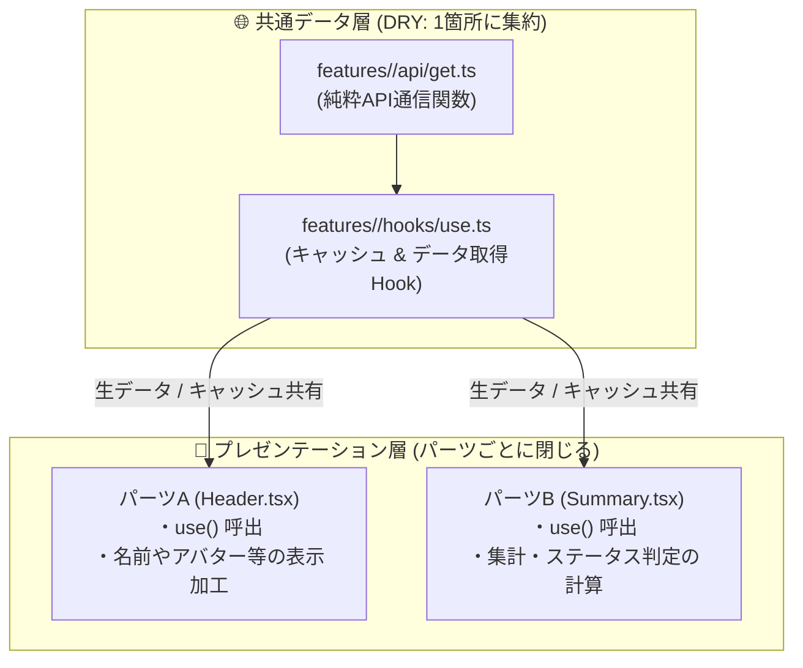

# 5. ドメイン内でのAPI共通化とパーツ別データ変換 (Two-Tier Data Pattern)

同一ドメイン内で複数のUIパーツが同じAPIデータを必要とする場合（例: Header, Graph, BillingStatus）、以下の**2層分離アプローチ**を適用します。

---

### 分離の基準
- **共通化するもの (DRY)**: 
  API通信関数 (`api/`) と キャッシュ管理Hook (`hooks/`)。重複fetchを防ぎ、データ整合性を担保する。
- **パーツに閉じるもの (疎結合)**: 
  画面表示のための加工・フォーマット・計算（ViewModel変換）。他パーツへの影響を遮断する。
