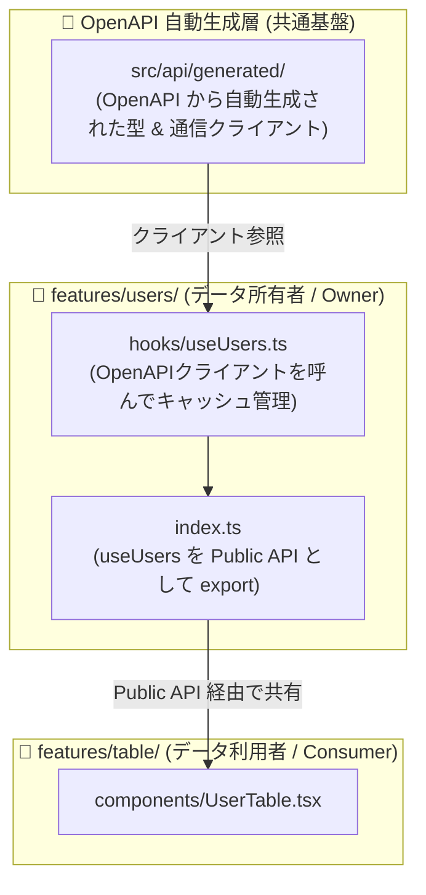

# 6. 複数ドメイン間のデータ共有 & OpenAPI 設計 (Cross-Feature & OpenAPI)

複数 Feature（例: `users` と `table`）が同じデータや OpenAPI 自動生成クライアントを必要とする場合の指針です。

---

### 1. OpenAPI 自動生成コードの配置
- OpenAPI Spec（Swagger）から生成された API 関数・型定義は、特定 Feature ではなく **共通基盤層 (`src/api/generated/`)** に配置します。

---

### 2. データ所有者（Owner）による Public API 公開
- データの本来の持ち主（Single Source of Truth: `features/users`）の `index.ts` からデータ取得 Hook を公式に export します。
- 利用側（`features/table`）は `import { useUsers } from '@/features/users'` として参照します。

---

### 3. ⚠️ 循環参照の厳禁（One-Way Dependency）
- 依存関係は常に「利用者 ➡️ 所有者（`table ➡️ users`）」の単方向に保ち、お互いに import し合う循環参照を防止します。
