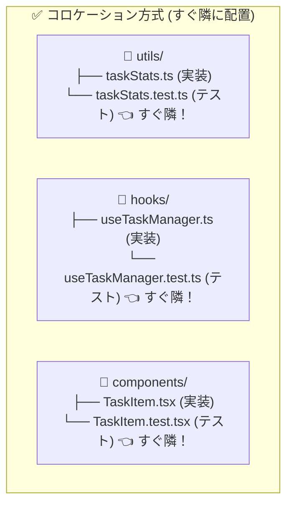

# 10. テストファイルのコロケーション設計 (Co-located Tests)

現代の React / TypeScript 開発において最も推奨される **「テスト対象ファイルのすぐ隣にテストコードを置く（コロケーション方式）」** の設計指針です。



---

## 📁 ディレクトリ構造例 (Aパターン: コロケーション)

```text
features/<domain>/
├── components/
│   ├── TaskItem.tsx
│   ├── TaskItem.test.tsx       # 👈 UIの単体・描画テスト
│   ├── TaskForm.tsx
│   └── TaskForm.test.tsx
│
├── hooks/
│   ├── useTaskManager.ts
│   └── useTaskManager.test.ts  # 👈 状態・CRUD操作のHookテスト
│
├── utils/
│   ├── taskStats.ts
│   └── taskStats.test.ts       # 👈 純粋関数の単体テスト (超高速)
│
├── types/
│   └── index.ts
│
└── index.ts                    # 🌟 Public API (※テストファイルは export しない)
```

---

## 🌟 コロケーション方式が支持される 3大メリット

### 1. 探す手間がゼロ（開発生産性の向上）
エディタのエクスプローラー上で、実装ファイルとテストファイルが常に上下に並ぶため、ファイルを即座に切り替えて TDD（テスト駆動開発）やバグ修正が行えます。

### 2. リファクタリング時の「孤児テスト（Orphan Test）」の防止
実装ファイルを削除・移動・名前変更した際、すぐ隣にあるテストファイルも一緒に移動・削除されるため、使われなくなったテストが別フォルダに取り残されるゴミコード化を防げます。

### 3. インポートパスが最短で綺麗
```typescript
// 📁 features/tasks/utils/taskStats.test.ts
// 同じ階層なので相対パスが最短！
import { calculateCompletionRate } from './taskStats';
```

---

## 💡 画面全体のシナリオテスト（結合テスト）を置く場合

複数のコンポーネントが協調して動作する「画面全体の操作シナリオテスト（Integration Test）」のみ、特定単一ファイルが存在しないため、Feature 直下に配置するか、`tests/integration/` を設けます。

```text
features/<domain>/
├── components/ (単体テスト同居)
├── hooks/ (単体テスト同居)
├── utils/ (単体テスト同居)
├── TaskDashboard.test.tsx      # 👈 画面全体の結合テスト (メインコンポーネントの隣)
└── index.ts
```
