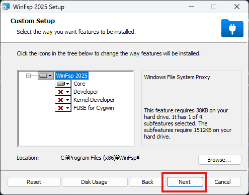
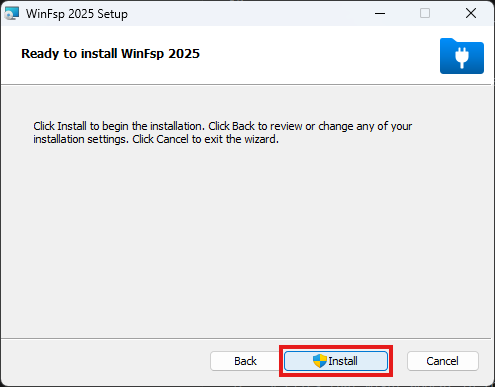
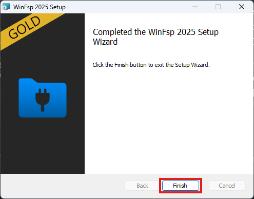

# GoogleドライブのデータセットをローカルPCで使うための環境構築手順書

Google ドライブ上に保存した大容量データセット（AudioSet等）を、ローカル PC のストレージを消費せずに仮想ディレクトリとしてマウントし、Cursor や VS Code などのローカル開発環境（WSL2 / Docker を含む）から直接ストリーミングで利用するためのセットアップ手順です。

---

## 🚀 構成の選択

開発環境の構成に合わせて、以下のいずれかの方法でマウントを行います。
* **パターン A: WSL2 内で直接マウントする（推奨・Docker / WSL開発向け）**
  WSL2 Linux 内で直接マウントを行うため、ファイルI/Oが高速で、Dockerコンテナへのボリュームマウントもパーミッションエラーなく正常に動作します。
* **パターン B: Windows 側でマウントする（Windows単体開発向け）**
  Windowsの仮想ドライブ（G:など）としてマウントします。WSL2やDockerを使用せず、Windowsのローカル開発環境（VS Code等）から直接アクセスする場合に向いています。

---

## 🔑 1. Windows 側での事前準備（独自の Client ID の作成）

Google ドライブの API 制限（レートリミット）を回避し、高速かつ安定したストリーミングを実現するため、自分専用の **OAuth クライアント ID** を作成します。

> [!TIP]
> **💡 独自のクライアントIDの作成手順（推奨）**
> rcloneのデフォルト共有キーを使用すると、他のユーザーとアクセス枠を共有するため、データ転送制限や速度低下が発生しやすくなります。安定した高速ストリーミングを行うには、以下の手順で自分専用のクライアントIDを作成して設定してください。
>
> 1. **Google Cloud Consoleへのアクセス**:  
>    [Google Cloud Console](https://console.cloud.google.com/) にGoogleアカウントでログインします。
> 2. **プロジェクトの作成**:  
>    画面上部から「プロジェクトの選択」をクリックし、「新しいプロジェクト」を作成します（プロジェクト名は **`my-rclone-project`** と入力します）。
> 3. **Google Drive APIの有効化**:  
>    メニューから「APIとサービス」＞「ライブラリ」を開き、検索窓に「Google Drive API」と入力して、これを有効化します。
> 4. **OAuth 同意画面の設定**:  
>    メニューから「APIとサービス」＞「OAuth 同意画面」（または「Google Auth Platform」）を開きます。
>    * 「Google Auth Platform はまだ構成されていません」という画面が表示される場合は、**「開始」**（または Get Started）ボタンをクリックします。
>    * User Type の選択画面が表示されたら、個人アカウントなら **「外部（External）」**（組織アカウントなら「内部」）を選択して「作成」をクリックします。
>    * アプリ名（例: `rclone`）、ユーザーサポートメール、デベロッパーの連絡先情報を入力し、他はデフォルトのまま「保存して次へ」を進め、最後にダッシュボードに戻ります。
>    * **ダッシュボードの対象を選択し、公開ステータスをアプリの公開にする**（テスト状態のままだと認証トークンの有効期限が1週間で切れてしまうため、必ず公開してください）。
> 5. **認証情報の作成**:  
>    メニューから「APIとサービス」＞「認証情報」を開き、画面上部の「+ 認証情報を作成」から **「OAuth クライアント ID」** を選択します。
>    * アプリケーションの種類: **「デスクトップ アプリ」** を選択。
>    * 名前: 任意の名前（例: `rclone`）を入力し、「作成」をクリックします。
> 6. **IDとシークレットの取得**:  
>    画面に **「クライアント ID」** と **「クライアント シークレット」** が表示されるので、メモ帳などにコピーしておきます。

---

## 🐧 パターン A: WSL2 内で直接マウントする（推奨・Docker向け）

WSL2 内で直接 Google ドライブをマウントする手順です。

### ① 必要なパッケージのインストール
WSL2 のターミナルで以下を実行し、マウント用の FUSE ドライバーと rclone をインストールします。
```bash
sudo apt update
sudo apt install -y fuse3 rclone
```

### ② rclone の連携設定（初回のみ）
1. WSL2 ターミナルで設定コマンドを実行します。
   ```bash
   rclone config
   ```
2. 以下の項目を入力して進めます（対話式）。
   * `n/s/q>` ➔ **`n`** (New remote)
   * `name>` ➔ **`gdrive`** (この名前をマウント時に使用します)
   * `Storage>` ➔ **`drive`** (Google Drive を選択)
   * `client_id / client_secret` ➔ 先ほど作成した「クライアント ID」と「クライアント シークレット」をそれぞれコピーして入力。
   * `scope>` ➔ **`1`** (フルアクセス権限)
   * `service_account_file / Edit advanced config` ➔ 何も入力せず Enter (デフォルト)
   * `Use auto config` ➔ **`y`** (Yes)
     ※ Windows 側のブラウザが自動で起動します。Google アカウントを選択し、「詳細」＞「rclone（安全ではないページ）に移動」＞「許可」の順に進め、「Success!」と表示されたらターミナルに戻ります。
   * `Configure this as a Shared Drive` ➔ マイドライブなら **`n`**、共有ドライブなら **`y`**
   * `Keep this "gdrive" remote` ➔ **`y`**
   * `q` を入力して設定を終了。

### ③ マウントの実行
WSL2 側にマウント用のディレクトリ（例：`~/workspace/gdrive`）を作成し、バックグラウンドでマウントを実行します。
```bash
# マウント用フォルダの作成
mkdir -p ~/workspace/gdrive

# 読み込み専用・バックグラウンドでマウント実行
rclone mount gdrive: ~/workspace/gdrive --vfs-cache-mode full --links --read-only &
```
* `--vfs-cache-mode full`: キャッシュを有効にし、ストリーミング再生をスムーズにします。
* `--links`: シンボリックリンクやショートカットをエラーなく読み込みます。
* `--read-only`: 読み込み専用にします。書き込み処理の同期が発生しないため、動作が非常に高速化します（学習用データセット等に最適）。

### ④ WSL2 起動時の自動マウント設定（永続化）
WSL2 を起動するたびに手動マウントするのは面倒なため、`~/.bashrc` に自動マウント処理を追記します。

1. `~/.bashrc` を開き、最下部に以下のコードを追記して保存します。
   ```bash
   # rclone が起動していない場合のみマウントを実行する
   if ! pgrep -x "rclone" > /dev/null; then
       rclone mount gdrive: ~/workspace/gdrive --vfs-cache-mode full --links --read-only &
   fi
   ```
2. これにより、WSL2 のターミナルを起動した際に、自動でバックグラウンドでのマウント処理が走るようになります。

---

## 💻 パターン B: Windows 側でマウントする（Windows単体開発向け）

Windows の仮想ドライブとしてマウントし、WSLを使用しないローカル環境で直接利用する手順です。

### ① WinFsp & Windows版 rclone のインストール
1. [WinFsp 公式サイト](https://winfsp.dev/) にアクセスし、最新のインストーラー（`.msi`）をダウンロードしてデフォルトのままインストールを完了させます。
   * **Custom Setup 画面**
     
   * **Ready to install WinFsp 2025 画面**
     
   * **Completed the WinFsp 2025 Setup Wizard 画面**
     
2. PowerShell を管理者権限で開き、以下を実行して rclone をインストールします。
   ```powershell
   winget install rclone.rclone
   ```

### ② rclone の連携設定
Windows の PowerShell で `rclone config` を実行し、パターン A の「② rclone の連携設定」と同様に設定を完了させます。

### ③ Windows 側でのマウント実行
PowerShell で以下のコマンドを実行します（マウント中は PowerShell を開いたままにします）。
```powershell
rclone mount gdrive: G: --vfs-cache-mode full --network-mode --links --read-only
```
* `--network-mode`: Windowsにネットワークドライブとして認識させ、エクスプローラーでの動作を安定させます。

### ④ Windows 起動時の自動マウント設定（永続化）
1. `Win + R` ＞ `shell:startup` でスタートアップフォルダを開きます。
2. フォルダ内に `rclone-mount.vbs` という名前の新規ファイルを作成し、中身に以下を貼り付けて保存します。
   ```vbs
   CreateObject("Wscript.Shell").Run "rclone mount gdrive: G: --vfs-cache-mode full --network-mode --links --read-only", 0, False
   ```
3. PC 起動時にバックグラウンドで自動マウントが実行されます。

---

## 🐳 Docker コンテナから利用する方法（パターン A 推奨）

WSL2 内で直接マウントした Google ドライブ（`~/workspace/gdrive`）は、Docker のバインドマウントを使ってコンテナ内に通常のディレクトリとしてマウントできます。

* **docker コマンドでの例**:
  ```bash
  docker run -it -v ~/workspace/gdrive/マイドライブ/dataset:/workspace/dataset python:3.10 bash
  ```
* **docker-compose.yml での例**:
  ```yaml
  services:
    app:
      image: python:3.10
      volumes:
        - ~/workspace/gdrive/マイドライブ/dataset:/workspace/dataset
  ```

> [!IMPORTANT]
> **注意点**
> 1. **マウントの順序**: 必ずホスト側（WSL2内）で `rclone mount` が**完了した状態**で Docker コンテナを起動してください。コンテナ起動後にマウントしても、コンテナ内には反映されません。
> 2. **パターン B (Windowsマウント) を使う場合の注意**: Windows側でマウントした `G:` ドライブを Docker に渡す場合、I/Oの階層が多くなるためファイル読み書きが極端に遅くなります。コンテナ開発を行う場合は、必ず **「パターン A（WSL2直接マウント）」** を選択してください。

---

## 🔍 トラブルシューティング

### Q. 認証時に `Error: Auth Error / Description: No code returned by remote server` が発生する
* **原因1: Googleの警告画面を突破していない可能性があります。**
  * **対策**: 画面左下の **「詳細（Advanced）」** ＞ **「rclone（安全ではないページ）に移動」** ＞ **「続行（許可）」** の順にクリックし、ブラウザに「Success!」と表示されるまで進めてください。
* **原因2: ローカルポートがセキュリティソフト等でブロックされている可能性があります。**
  * **対策**: リダイレクト先として `http://127.0.0.1:53682/` が許可されていることを確認し、セキュリティソフトのリアルタイム保護やファイアウォールを一時的に無効化して再試行してください。

### Q. `Enter verification code (config_token) >` または `config_token>` と表示されて止まってしまう
* **原因: 自動認証が機能せず、手動認証モードに入っています。**
  * **対策**: 一度 **`Ctrl + C`** キーを押して設定を強制終了します。再度 `rclone config` を実行し、`Use web browser to automatically authenticate rclone with remote?` で必ず **`y` (Yes)** を入力して Enter を押し、ブラウザを介した自動連携を行ってください。

### Q. マウント実行時に `ERROR : symlinks not supported without the --links flag: /` が発生する
* **原因: Google ドライブ内にシンボリックリンクやショートカットが含まれていますが、`--links` オプションが指定されていません。**
  * **対策**: エクスプローラー上でドライブが見えていればそのまま使用可能ですが、エラーログが気になる場合やショートカットを正常に処理したい場合は、マウントコマンドの末尾に **`--links`** オプションを追加して実行してください。

### Q. マウントしたドライブを開く際、エクスプローラーが「ぐるぐる」して読み込みが非常に遅い
* **原因1: 初回のファイル一覧情報（キャッシュ）をロードするのに時間がかかっています。**
  * **対策**: Google ドライブ内のファイル数が多い場合、初回アクセス時に数分間ローディング状態になります。最初のロードが終わればキャッシュされ、以降はスムーズに開くようになりますので、数分間そのまま待機してください。
* **原因2: ネットワーク内の新規ドライブに対して、Windows Defender 等のウイルス対策ソフトがリアルタイムスキャンを走らせている可能性があります。**
  * **対策**: セキュリティソフトのスキャン完了を待つか、Googleドライブへの書き込みが不要な場合は、マウントコマンドに **`--read-only`** を追加して実行してください。書き込み処理のオーバーヘッドがなくなり、読み込みが劇的に高速化します。