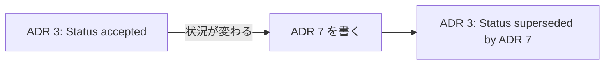

# ADR の書き方

ADR（Architecture Decision Record）は、重要な設計の決定を、1 つの決定につき 1 つの短いファイルに残す書き方である。
目的は、未来の開発者が決定の理由と結果を知ったうえで、受け入れるか変えるかを判断できるようにすることである。
内容は、ADR を提案した Michael Nygard の記事をもとにしている。

## ADR を書く理由

- 決定は、プロジェクトの途中で少しずつ行われる。
  そして、最も追いにくいのが決定の動機である。
- 理由を知らない人には、盲目的に受け入れるか、盲目的に変えるかの 2 つしか選べない。
  受け入れ続けると、見直すべき決定まで残り、変えるのが怖くなる。
  変えてしまうと、その決定が支えていたものを気づかずに壊すおそれがある。
- 大きな文書は更新されず、読まれもしない。
  決定ごとに小さく分けると、更新されやすく、読みやすい。

## ADR に書く決定

- 対象は、アーキテクチャ上重要な決定だけにする。
  構造、非機能の特性（性能や信頼性など）、依存関係、インターフェース、作り方の技法に影響する決定を指す。
- 1 つの ADR には、1 つの決定だけを書く。
  その決定が、プロジェクトのほかの部分の進め方に影響するものであること。

## ADR の形式

1 つの ADR は、次の 5 つの節で書き、全体を 1〜2 ページに収める。

| 節 | 書くこと |
| :-- | :-- |
| Title | 短い名詞句。番号を付ける（例: 「ADR 9: LDAP for Multitenant Integration」） |
| Context | 決定のときに働いていた力（技術、組織、プロジェクト固有の事情）。引っ張り合う力はそうと書く。価値判断を入れず、事実だけを書く |
| Decision | 力への対応。完全な文で、「〜する」と能動態で書く |
| Status | 合意前は proposed、合意後は accepted。後の ADR で変わったら deprecated か superseded とし、置き換えた ADR を示す |
| Consequences | 決定を適用した後の状況。良い結果だけでなく、悪い結果も中立の結果もすべて書く |

- 未来の開発者との会話のつもりで、完全な文で書く。
  箇条書きを、文の断片を並べる言い訳にしない。

## ADR の置き方と番号

- ADR はコードと同じリポジトリに、Markdown などの軽い書式で置く。
- 番号は連番で振り、再利用しない。
  記事の例では、ファイル名は `adr-NNN.md` と 3 桁、タイトルは「ADR 9」と桁を埋めずに書いている。
- 決定が覆っても、古い ADR は消さない。
  新しい ADR を書き、古い ADR の Status を superseded にして、新しい ADR を示す。
  「かつての決定だったが、今の決定ではない」ことにも意味がある。

## ADR が積み重なると

- 1 つの ADR の結果は、後の ADR の背景になりやすい。
  大きな決定が、小さな決定の入る余地を作る。
- メンバーが入れ替わっても、過去の決定の動機が残る。
  状況が変われば、どの決定を見直す時期かも分かる。
- 将来の大きな作り直しの意図を書き残すと、その変更をうっかり難しくすることを防げる。

## See also

- [Documenting Architecture Decisions 要約](/references/cognitect/documenting-architecture-decisions.md)
- [ドキュメントの考え方](/knowledge/documentation-philosophy.md)
