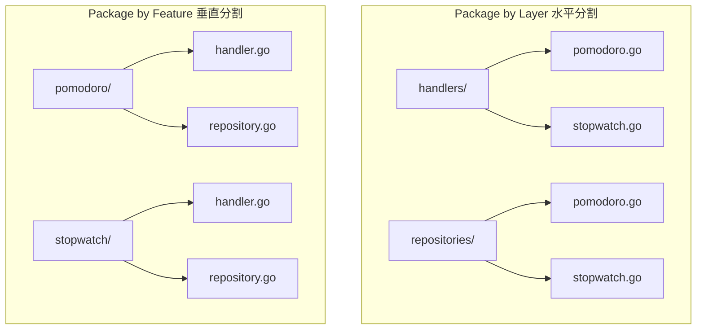

# Package by Feature 設計指針

Package by Feature は、コードを技術レイヤーではなく業務機能（Pomodoro など）単位で垂直分割する設計指針である。機能の変更・追加・削除を 1 ディレクトリ内で完結させ、保守性を高めるために採用する。

## 1. Package by Feature とは

システムを「技術レイヤー（Handler、Repository など）」ごとに水平分割するのではなく、「業務機能（Pomodoro、Stopwatch など）」単位で垂直分割してパッケージを構成する設計手法である。



## 2. 設計比較

| 比較項目           | Package by Layer 水平分割              | Package by Feature 垂直分割                   |
| :----------------- | :------------------------------------- | :-------------------------------------------- |
| 分割の軸           | 技術的関心ごと（HTTP、SQL）            | 業務機能・ドメイン関心ごと                    |
| コードの凝集度     | 低い（同一機能のコードが各層に散乱）   | 高い（関連するコードが 1 ディレクトリに集約） |
| 機能修正時の影響   | 複数ディレクトリを行き来する必要がある | 対象機能のディレクトリ内だけで完結する        |
| 新機能追加         | 既存の各レイヤーディレクトリに追記     | 新しい機能ディレクトリを丸ごと追加するだけ    |
| 削除・破棄の容易性 | 各層から関連ファイルを拾い集めて削除   | 機能ディレクトリを丸ごと削除するだけで完了    |

## 3. ディレクトリ構成例

```text
backend/internal/
├── pomodoro/            # ポモドーロ機能のすべてを集約
│   ├── handler.go       # HTTP ハンドラー
│   ├── handler_test.go  # ハンドラーのテスト
│   ├── usecase.go       # ユースケース（業務ロジック）
│   ├── usecase_test.go
│   ├── repository.go    # DB アクセス・SQL 実行
│   └── repository_test.go
│
└── stopwatch/           # 将来のストップウォッチ機能
    ├── handler.go
    ├── usecase.go
    └── repository.go
```

## 4. 決定理由（Rationale）

1. 認知的負荷の最小化:
   - ポモドーロ機能の改修時は `internal/pomodoro/` だけに集中でき、無関係な機能のコードが視界に入らない。
1. 変更の局所化（高凝集・疎結合）:
   - 機能内の変更が他の機能に波及しないため、新機能の追加や不要機能の安全な削除が可能。
1. フロントエンドとバックエンドの思想の一致:
   - フロントエンド（`frontend/features/pomodoro/`）とバックエンド（`backend/internal/pomodoro/`）で同一の機能境界を共有でき、チーム全体の共通言語となる。

## See also

- [バックエンドアーキテクチャ](/backend/architecture.md)
- [フロントエンド Pomodoro 機能](/frontend/features/pomodoro.md)
- [テーブル駆動テスト](/knowledge/table-driven-tests.md)
