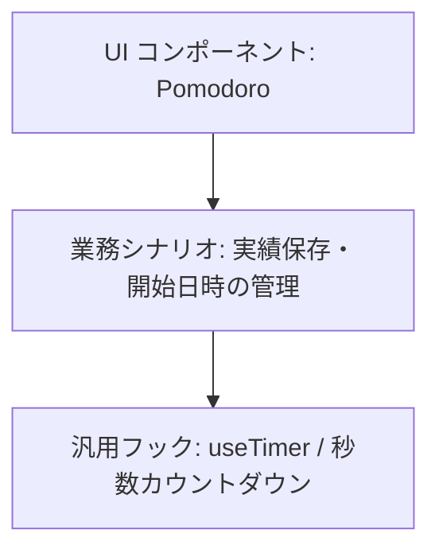

# React カスタムフックの責務分離とライフサイクル設計指針

カスタムフックは、汎用部品と業務ロジックを分離し、`setInterval` などの副作用を `useEffect` で確実に破棄して設計する。保守性・再利用性・テスト容易性を保つための設計パターンをまとめる。

## 1. 汎用フックと業務ロジックの分離（関心の分離）

フックを設計する際、「低レイヤーの汎用部品（道具）」と「高レイヤーのドメイン業務（シナリオ）」を 1 つのフックに同居させてはならない。



### 責務比較

| 分類                             | 責務の例                                      | 知るべきこと                                 | 知るべきでないこと                            |
| :------------------------------- | :-------------------------------------------- | :------------------------------------------- | :-------------------------------------------- |
| 汎用フック（`useTimer`）         | 指定秒数を 1 秒ずつ減らし、停止・リセットする | 秒数、カウント状態（`isRunning`）            | ポモドーロ、開始日時（`startedAt`）、API 通信 |
| 業務ロジック（コンポーネント等） | ポモドーロ実績を記録し、API へ送信する        | 開始日時の追跡、API クライアント、エラー処理 | `setInterval` の登録・解除・ミリ秒計算の詳細  |

### コールバック（`onComplete`）による制御の反転（IoC）

タイマーフックは「時間がゼロになった後どうするか」を決めず、ボタンの `onClick` と同様に「ゼロになったこと」だけを `onComplete()` で外部に通知する。これにより、タイマーフックは完全に独立したテストと再利用が可能になる。

## 2. `useRef` の本質と Latest Ref パターン

### 3 つの変数の性質比較

React における変数の持ち方は、用途に応じて厳格に使い分ける。

| 手法                  | 再レンダリングで値が消えるか | 値の更新で画面が再描画されるか | 主な用途                                 |
| :-------------------- | :--------------------------- | :----------------------------- | :--------------------------------------- |
| ローカル変数（`let`） | 消える（リセット）           | されない                       | その計算の瞬間のみ使う使い捨てデータ     |
| `useState`            | 残る                         | される                         | 画面に直接表示するデータ（残り時間など） |
| `useRef`              | 残る                         | されない                       | 画面に直接表示しない裏方のデータ・メモ帳 |

### Latest Ref パターン（タイマーのリセット防止と最新値参照の両立）

タイマーなどの非同期ループ内で外部コールバックを呼ぶ場合、依存配列にコールバックを渡すと「親の再レンダリングのたびにタイマーが再作成（リセット）される」という問題が発生する。

`useRef` を用いて最新の関数参照を保持することで、タイマーのループをリセットさせずに、常に最新の関数を呼ぶことができる。

```typescript
// ① 最新のコールバックを保持する箱を作成
const onCompleteRef = useRef(onComplete);
useEffect(() => {
  onCompleteRef.current = onComplete;
}, [onComplete]);

// ② タイマーは isRunning のみに依存させ、親の再レンダリングでリセットさせない
useEffect(() => {
  if (!isRunning) return;

  const timerId = setInterval(() => {
    setTimeLeft((prev) => {
      if (prev <= 1) {
        setIsRunning(false);
        onCompleteRef.current?.(); // 実行時は常に最新の関数が呼ばれる
        return 0;
      }
      return prev - 1;
    });
  }, 1000);

  return () => clearInterval(timerId);
}, [isRunning]);
```

## 3. `setInterval` のライフサイクルとメモリリーク防止

1. `setInterval` の無限ループ性:
   - `clearInterval(timerId)` を呼ぶまで、ブラウザ上で永久にコールバックを実行し続ける。
1. クリーンアップの徹底:
   - `useEffect` の戻り値として `return () => clearInterval(timerId);` を必ず返す。
   - `isRunning` が `false` に変化した際、およびコンポーネントがアンマウントされた際に確実にタイマーを破棄し、メモリリークとバックグラウンドでの暴走を防ぐ。
1. テストにおける `act` の分割:
   - `start()` による `setIsRunning(true)` が実行されても、`setInterval` が登録されるのは 再レンダリング後の `useEffect` である。
   - テスト内でタイマー開始と時間進行（`vi.advanceTimersByTime`）を同一の `act` 内に同居させるとタイマー登録前に時間が進んで空振りするため、`act` を分割してライフサイクルを明示的に同期させる。

## 4. 決定理由（Rationale）: YAGNI の解釈

- YAGNI で避けるべきこと:
  - 要件にない未知の機能や、使われない引数・設定オプションの先回り実装。
- YAGNI を口実にしてはならないこと:
  - 単一責任の原則（SRP）や関心の分離（SoC）を怠り、「コード量が少ないから」と汎用機能と業務シナリオを 1 ファイルに癒着させること。
  - テストの書きにくさやノイズは責務混同のサインであり、最初から変更に強いクリーンな境界線を引く。

## See also

- [`AGENTS_LEARNING.md`](../../AGENTS_LEARNING.md)
- [`docs/knowledge/aaa-pattern.md`](/knowledge/aaa-pattern.md)
- [`docs/knowledge/package-by-feature.md`](/knowledge/package-by-feature.md)
- [`frontend/features/pomodoro/hooks/use-timer.ts`](../../frontend/features/pomodoro/hooks/use-timer.ts)
- [`frontend/features/pomodoro/hooks/use-timer.test.ts`](../../frontend/features/pomodoro/hooks/use-timer.test.ts)
