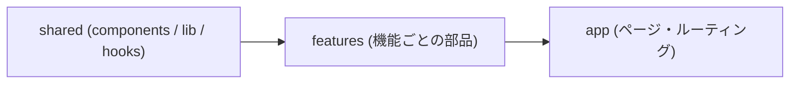

# Bulletproof React の全体像

Alan Alickovic が公開している `bulletproof-react` の設計指針の要約である。React は自由度が高いぶん設計が散らかりやすいため、本番運用に耐えるシンプルなディレクトリ構成・依存ルール・状態管理・API 層の型を定めている。

## 1. ディレクトリ構成と `features/` 中心の整理

コードの大半は業務機能ごとの `features/<機能名>/` に置き、アプリ全体で共有するものだけを最上位の `components/`・`hooks/`・`lib/`・`utils/` に置く。

```text
src/
├── app/         # ルーティング・全体 Provider・ページの入口
├── components/  # アプリ全体で使う汎用 UI コンポーネント
├── features/    # 業務機能ごとのモジュール（api, components, hooks, stores, types）
├── hooks/       # アプリ全体で使う汎用カスタムフック
├── lib/         # 設定済みの外部ライブラリ（API クライアント等）
├── stores/      # グローバルな状態ストア
├── types/       # アプリ全体で共有する型
└── utils/       # 汎用ユーティリティ関数
```

## 2. 単方向の依存ルール（Unidirectional Codebase）

依存の向きは必ず **`shared（components / hooks / lib / utils）→ features → app`** の一方向に制限する。



- `features/A` から `features/B` を直接 import してはならない（機能間の結合を防ぐため）。
- 複数の機能を1つの画面で組み合わせたいときは、上位の `app/`（ページ）側で両方の機能を並べて合成する。

## 3. コンポーネント設計の原則

- **Colocation（局所化）**: コンポーネント・関数・スタイル・状態は、使われる場所にできるだけ近い階層に置く。最初から `src/components/` に置かず、まず `features/` 内に作り、複数機能で必要になってから共通化する。
- **レンダー関数の分離**: コンポーネント内部に `renderItems()` のような関数をいくつも作らず、独立した子コンポーネントとして切り出す。
- **Props の数を抑える**: 受け取る Props が増えすぎたら、コンポーネントを分割するか、`children` や Slot を渡す合成（Composition）パターンを使う。

## 4. 状態（State）の5分類

すべての状態を1つのグローバルストアに入れず、用途ごとに5つに分けて管理する。

| 分類                   | 役割と具体例                                                           | 主な管理手段                    |
| :--------------------- | :--------------------------------------------------------------------- | :------------------------------ |
| **Component State**    | 単一コンポーネント内の閉じた状態（開閉、入力途中の値）                 | `useState`、`useReducer`        |
| **Application State**  | 画面横断の UI 状態（グローバルモーダル、通知、テーマ）                 | Context + Hooks、Zustand、Jotai |
| **Server Cache State** | サーバーから取得したデータのキャッシュ・再取得状態                     | TanStack Query、SWR             |
| **Form State**         | フォームの入力値・バリデーション・送信中状態                           | React Hook Form + Zod           |
| **URL State**          | URL パスパラメータやクエリ文字列に持たせる状態（検索条件・ページ番号） | Router の SearchParams          |

## 5. API 層とエラーハンドリング

- **単一の API クライアント**: `lib/api-client.ts` に共通設定（ベース URL、認証ヘッダ、共通エラーインターセプター）を持つクライアントを1つ用意する。
- **リクエスト宣言とフックの分離**: 各機能の `features/<機能名>/api/` ごとに、①データ型・スキーマ、②API 呼び出し関数、③データ取得フック（Query / Mutation）をセットで定義する。
- **エラーの二段構え**: API 通信エラーはインターセプターで通知を出し、UI の描画クラッシュは領域ごとの Error Boundary で受け止めて画面全体の白紙化を防ぐ。

## See also

- [alan2207/bulletproof-react (GitHub)](https://github.com/alan2207/bulletproof-react)
- [Bulletproof React: Project Structure](https://github.com/alan2207/bulletproof-react/blob/master/docs/project-structure.md)
- [Next.js の app/ と features/ の分担](/knowledge/nextjs-app-and-features.md)
