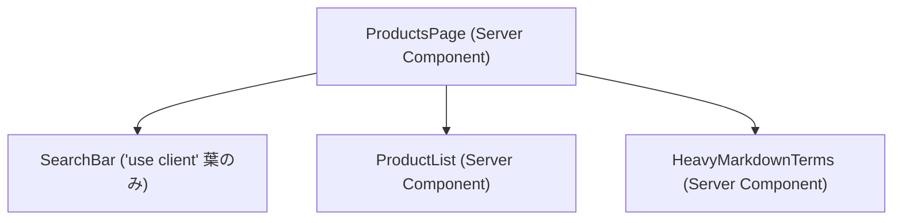

# Server Components と Client Components の境界設計

Next.js App Router（React 19）では、すべてのコンポーネントはデフォルトで **Server Components (RSC)** として動作し、ブラウザ上の状態やイベント操作が必要な箇所だけを **`'use client'`（Client Components）** として切り出す設計を採る。境界設計で最も重要な原則は、**「`'use client'` をコンポーネントツリーの末端（葉）へ押し下げること」** と **「Client Component の `children` として Server Component を注入する（コンポジション）こと」** の2点である。この2つを守ることで、ブラウザへ送信される JavaScript バンドルを最小限に抑えつつ、サーバー直結の高速なデータ取得とリッチな UI 操作を両立できる。

## Server Components と Client Components の役割分担

Server Components と Client Components は「優劣」ではなく「実行環境と得意な責務」が異なるため、それぞれの機能要件に応じて使い分ける。

| 機能・やりたいこと                                                    | Server Component (デフォルト) |                 Client Component (`'use client'`)                 |
| :-------------------------------------------------------------------- | :---------------------------: | :---------------------------------------------------------------: |
| バックエンド API・DB からの直接データ取得（`async / await`）          |             **○**             | ×（初期データは Server から渡すか SWR / TanStack Query 等を使う） |
| 秘匿情報（API キー・内部トークン・環境変数）の安全な保持              |             **○**             |  ×（`NEXT_PUBLIC_` 以外は参照不可・コードがブラウザに露出する）   |
| 重い依存ライブラリをクライアント JS バンドルに含めない                |             **○**             |          ×（import したモジュールがバンドルに含まれる）           |
| React State とライフサイクル（`useState`, `useReducer`, `useEffect`） |               ×               |                               **○**                               |
| イベントハンドラ（`onClick`, `onChange`, `onSubmit`）                 |               ×               |                               **○**                               |
| ブラウザ専用 API（`window`, `localStorage`, Geolocation 等）          |               ×               |                               **○**                               |
| カスタムフック（状態や副作用を伴うもの）                              |               ×               |                               **○**                               |

`'use client'` ディレクティブは「サーバーとクライアントのモジュール境界線」を宣言するものである。あるファイルに `'use client'` を記述すると、**そのファイルが直接 `import` しているすべてのサブモジュール（子コンポーネントやユーティリティ）も自動的にクライアントバンドルの対象** になる点に注意が必要である。

## 原則1：`'use client'` をツリーの末端（葉）に押し下げる

画面のヘッダー内にある検索入力欄や、記事詳細ページにある「いいねボタン」など、一部に対話操作が必要になった際、ページ全体（`page.tsx`）や巨大なレイアウト全体に `'use client'` を付けてはならない。操作や状態が必要な最小単位（ツリーの葉にあたるコンポーネント）だけを切り出して `'use client'` を付与する。



### 悪い例：ページ全体に `'use client'` を付けてしまう

```tsx
// app/products/page.tsx
'use client'; // NG: ページ全体が Client Component 化してしまう

import { useState } from 'react';
import { ProductList } from './ProductList';
import { HeavyMarkdownTerms } from './HeavyMarkdownTerms';

export default function ProductsPage() {
  const [query, setQuery] = useState('');

  return (
    <main>
      <h1>商品一覧</h1>
      <input value={query} onChange={(e) => setQuery(e.target.value)} />
      <ProductList query={query} />
      <HeavyMarkdownTerms />
    </main>
  );
}
```

### 良い例：対話が必要な最小パーツだけを Client Component に切り出す

```tsx
// app/products/SearchBar.tsx
'use client'; // OK: 入力状態を管理する葉のコンポーネントだけを Client 化する

import { useState } from 'react';

export function SearchBar() {
  const [query, setQuery] = useState('');
  return (
    <input
      type="search"
      value={query}
      onChange={(e) => setQuery(e.target.value)}
      placeholder="商品を検索..."
    />
  );
}
```

```tsx
// app/products/page.tsx (Server Component のまま維持)
import { SearchBar } from './SearchBar';
import { ProductList } from './ProductList';
import { HeavyMarkdownTerms } from './HeavyMarkdownTerms';

export default async function ProductsPage() {
  // OK: サーバー側で直接データを取得でき、静的パーツの JS もブラウザに送られない
  const products = await fetchProducts();

  return (
    <main>
      <h1>商品一覧</h1>
      <SearchBar />
      <ProductList products={products} />
      <HeavyMarkdownTerms />
    </main>
  );
}
```

## 原則2：Client Component の `children` に Server Component を渡す（Interleaving / Composition）

モーダルの開閉状態やアコーディオン、タブ切り替え、スクロール連動の枠組みなど、「外側の枠（コンテナ）が `useState` を持つ Client Component であり、その中身として重い Server Component を表示したい」というケースが頻繁に発生する。このとき、Client Component のファイル内で Server Component を直接 `import` すると、その Server Component は Client Component として扱われてしまい、`async/await` によるサーバーデータ取得もできなくなる。

この問題は、**Client Component 側では中身を直接 `import` せず `children`（または任意の ReactNode 型 props）として受け取る穴（スロット）を開けておき、親の Server Component 上で両者を組み立てる（Composition / Interleaving）** ことで解決できる。

### 悪い例：Client Component の中で Server Component を直接 import する

```tsx
// components/Modal.tsx
'use client';

import { useState } from 'react';
// NG: Client Component 内で直接 import すると UserProfileServer も Client 境界に巻き込まれる
import { UserProfileServer } from './UserProfileServer';

export function Modal() {
  const [isOpen, setIsOpen] = useState(false);
  return (
    <div>
      <button type="button" onClick={() => setIsOpen(true)}>
        プロフィールを開く
      </button>
      {isOpen && (
        <div className="modal">
          <UserProfileServer />
        </div>
      )}
    </div>
  );
}
```

### 良い例：`children` props として外（Server Component）から渡す

```tsx
// components/Modal.tsx (Client Component)
'use client';

import { useState, type ReactNode } from 'react';

export function Modal({ children }: { children: ReactNode }) {
  const [isOpen, setIsOpen] = useState(false);
  return (
    <div>
      <button type="button" onClick={() => setIsOpen(true)}>
        プロフィールを開く
      </button>
      {isOpen && <div className="modal">{children}</div>}
    </div>
  );
}
```

```tsx
// app/dashboard/page.tsx (Server Component)
import { Modal } from '@/components/Modal';
import { UserProfileServer } from '@/components/UserProfileServer';

export default function DashboardPage() {
  // OK: 親の Server Component 上で組み立てて children として渡すため、
  // UserProfileServer はサーバー上で実行・描画された結果（RSC Payload）として Modal に渡される
  return (
    <section>
      <h1>ダッシュボード</h1>
      <Modal>
        <UserProfileServer />
      </Modal>
    </section>
  );
}
```

React にとって `Modal` が受け取る `children` は「すでに親（Server Component）側で評価・レンダリングが予約された React 要素の参照」に過ぎない。そのため、`Modal` 自身がクライアント側で再レンダリング（`isOpen` の切り替え）されても、`UserProfileServer` のコードがクライアントバンドルに含まれることはなく、サーバーコンポーネントとしての性質が完全に保たれる。

## Context Provider を切る位置の工夫

React の `createContext` は Server Components では利用できないため、テーマ管理やトースト通知、認証状態などの Context Provider を作る場合は `'use client'` が必須となる。しかし、`app/layout.tsx` 自体に `'use client'` を付けることはできない（Metadata API やサーバー処理が使えなくなるため）。

Context を導入する際は、以下の2つの工夫を行う。

1.  **Provider 専用の薄い Client Component ラッパーを作り、`children` パターンで囲む**: 上記の原則2と同じく、Provider コンポーネント自体を別ファイル（`ThemeProvider.tsx` 等）に切り出して `'use client'` を付け、`children` をそのまま包んで返す実装にする。これにより、`app/layout.tsx` や配下のページ群は Server Component のまま維持される。
1.  **Provider を本当に必要なサブツリーのできるだけ深い位置に配置する**: アプリ全体で使うテーマや認証はルートレイアウト（`app/layout.tsx`）に置く必要があるが、特定のウィザード画面やダッシュボード内だけで共有する Context であれば、ルートではなく該当機能の上位レイアウトやページ単位で囲む。これにより、無関係な画面でのクライアント初期化コストや再レンダリング範囲を最小化できる。

```tsx
// app/providers/ThemeProvider.tsx
'use client';

import { createContext, useState, type ReactNode } from 'react';

export const ThemeContext = createContext<'light' | 'dark'>('light');

export function ThemeProvider({ children }: { children: ReactNode }) {
  const [theme] = useState<'light' | 'dark'>('light');
  return <ThemeContext.Provider value={theme}>{children}</ThemeContext.Provider>;
}
```

```tsx
// app/layout.tsx (Server Component のまま維持)
import type { ReactNode } from 'react';
import { ThemeProvider } from './providers/ThemeProvider';

export default function RootLayout({ children }: { children: ReactNode }) {
  return (
    <html lang="ja">
      <body>
        <ThemeProvider>{children}</ThemeProvider>
      </body>
    </html>
  );
}
```

## See also

- [Next.js Documentation - Server and Client Components](https://nextjs.org/docs/app/getting-started/server-and-client-components)
- [React Documentation - Server Components](https://react.dev/reference/rsc/server-components)
- [React Documentation - 'use client'](https://react.dev/reference/rsc/use-client)
- [コンポーネントの合成パターン（Composition / Compound Components）](/learning/components-and-state/react-component-composition.md)
- [State の構造の原則（Choosing the State Structure）](/learning/components-and-state/choosing-the-state-structure.md)
