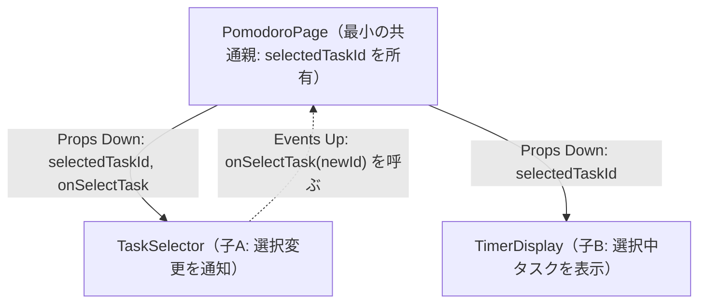

# どの部品で State を持ち、どう渡すか（State の所有権とデータフロー）

React 公式ドキュメント「Thinking in React」および「Sharing State Between Components」に基づく、**「どのコンポーネントで `useState` を呼び、どこへ渡すか」** の実践ガイドである。状態（State）は最初から上位のページやグローバル領域に置くのではなく、**「まず末端に置き（Colocation）、共有が必要になった時点で最小の共通親へ引き上げる（Lifting State Up）」** という手順で所有者を決める。

## 1. 手順1：State Colocation（状態の局所化）

新しい State が必要になったときは、まず **「その状態を必要とする一番末端のコンポーネント」** の内部に `useState` を配置する。これを **State Colocation（状態の局所化・近接配置）** と呼ぶ。

- 他のコンポーネントがその値を知る必要がない限り、親やページ全体には持ち上げない。
- たとえば、ドロップダウンの開閉状態（`isOpen`）や、ツールチップの表示状態、入力途中のローカルな一時文字列などは、その部品自身の内部に閉じ込める。

**メリット**:

1.  **再レンダリング範囲の局所化**: State が更新されても、その末端コンポーネントと配下の子要素だけが再レンダリングされ、ページ全体への影響を防げる。
1.  **部品の独立性向上**: 親コンポーネントが不要な State 管理で肥大化せず、部品単体でテスト・再利用しやすくなる。

## 2. 手順2：Lifting State Up（状態のリフトアップ）

開発が進み、**「兄弟コンポーネント同士で同じ状態を参照・同期したい」** という要件が生まれたタイミングで初めて、それらを包む **「最小の共通親コンポーネント（Closest Common Ancestor）」** に `useState` を引き上げる。

たとえば、ポモドーロタイマー画面で「タスク選択リスト（`TaskSelector`）」で選んだタスクを、隣の「タイマー表示（`TimerDisplay`）」にも表示したい場合を考える。



このとき、`TaskSelector` と `TimerDisplay` の両方に別々の `useState` を持たせて同期しようとしてはいけない。**「信頼できる唯一の情報源（Single Source of Truth）」** として共通親の `PomodoroPage` だけが `selectedTaskId` を所有し、子には Props 経由で配る。

## 3. 手順3：単方向データフロー（Props Down, Events Up）

React のデータは常に **親から子への単方向（One-Way Data Flow）** で流れる。子コンポーネントは親から受け取った Props を直接書き換えることはできないため、次のパターンでやり取りする。

1.  **Props Down（親 → 子）**: 親は現在の状態（`value` や `selectedTaskId`）をデータ Props として子へ渡す。
1.  **Events Up（子 → 親）**: 親は状態を更新するための関数（`onChange` や `onSelectTask`）をイベントハンドラ Props として子へ渡し、子はユーザー操作時にその関数を呼び出す。

```tsx
// 子の定義：自身では selectedTaskId の useState を持たず、親から受け取る
type TaskSelectorProps = {
  tasks: Task[];
  selectedTaskId: string | null;
  onSelectTask: (taskId: string) => void;
};

export function TaskSelector({ tasks, selectedTaskId, onSelectTask }: TaskSelectorProps) {
  return (
    <ul>
      {tasks.map((task) => (
        <li key={task.id}>
          <button
            type="button"
            aria-pressed={task.id === selectedTaskId}
            onClick={() => onSelectTask(task.id)} // Events Up: 親へ通知
          >
            {task.title}
          </button>
        </li>
      ))}
    </ul>
  );
}

// 親の定義：最小の共通親として State を所有し、兄弟へ配る
export function PomodoroPage({ tasks }: { tasks: Task[] }) {
  const [selectedTaskId, setSelectedTaskId] = useState<string | null>(null);
  const selectedTask = tasks.find((t) => t.id === selectedTaskId) ?? null;

  return (
    <div>
      {/* Props Down + Events Up */}
      <TaskSelector
        tasks={tasks}
        selectedTaskId={selectedTaskId}
        onSelectTask={setSelectedTaskId}
      />
      {/* Props Down */}
      <TimerDisplay activeTask={selectedTask} />
    </div>
  );
}
```

## 4. Controlled（制御）と Uncontrolled（非制御）の使い分け

コンポーネントの設計には、状態を親が握る **Controlled（制御コンポーネント）** と、部品内部に隠蔽する **Uncontrolled（非制御コンポーネント）** の 2 種類がある。

| 種類                       | 状態の所有者                                                      | 特徴                                                                         | 向いているケース                                                    |
| :------------------------- | :---------------------------------------------------------------- | :--------------------------------------------------------------------------- | :------------------------------------------------------------------ |
| **Controlled（制御）**     | **親コンポーネント**（`value` と `onChange` を Props で受け取る） | 親からいつでも値を参照・リセット・バリデーションでき、他の部品と連動しやすい | フォーム入力部品、検索フィルタ、他コンポーネントと状態を共有する UI |
| **Uncontrolled（非制御）** | **部品自身**（内部で `useState` や `useRef` を持つ）              | 呼び出し側の記述が最小限で済み、親の再レンダリングを引き起こさない           | 単体で完結するアコーディオン開閉、初期値だけ渡せばよい簡易 UI       |

### 使い分けの判断基準

- **汎用 UI 部品（`Input`、`Select`、`Checkbox`、`Dialog` 等）**: 原則として **Controlled（`value` + `onChange` または `open` + `onOpenChange`）** に対応する設計とする。親から制御できない汎用部品は、フォーム送信後のリセットや外部ボタンからの開閉ができず再利用時に詰まりやすい。
- **機能固有の複合部品**: 外部と連動しない内部 UI 状態（ホバー状態や一時的な編集モードのトグルなど）は **Uncontrolled（State Colocation）** として内部に隠し、親に公開する Props を最小限に保つ。

## 決定理由（Rationale）

状態の所有権が曖昧なまま複数のコンポーネントで `useState` を乱立させると、画面間で表示が食い違うバグ（同期ズレ）が必ず発生する。「まずは末端に局所化し（Colocation）、共有が必要になったら最小の共通親に引き上げ（Lifting State Up）、Props Down / Events Up で繋ぐ」という原則を徹底することで、データの発生源が常に 1 箇所（Single Source of Truth）に保たれ、データフローを追跡しやすくなる。

## See also

- [Thinking in React – React 公式ドキュメント](https://react.dev/learn/thinking-in-react)
- [Sharing State Between Components – React 公式ドキュメント](https://react.dev/learn/sharing-state-between-components)
- [State の構造の原則（Choosing the State Structure）](/learning/components-and-state/choosing-the-state-structure.md)
- [コンポーネントの合成パターン（Composition / Compound Components）](/learning/components-and-state/react-component-composition.md)
