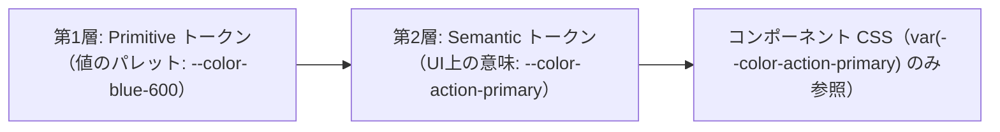

# デザイントークン（Design Tokens）と CSS 変数の 2 層設計

色・余白（スペーシング）・フォントサイズ・角丸・影などの視覚的な値をコンポーネントの CSS に直書き（マジックナンバー化）せず、名前付きの変数（**デザイントークン**）として体系化する手法である。特にカラー設計などでは、変数を 1 層だけで定義するのではなく、**「Primitive（基礎）トークン」と「Semantic（意味・役割）トークン」の 2 層** に分けることで、一貫性の維持・ダークモード対応・ブランド色変更を安全に行えるようになる。

## 1. なぜ CSS に値を直書きしてはいけないのか

コンポーネントごとの CSS ファイルに `#2563eb` や `14px`、`18px` といった生の値（ハードコード）を直接書くと、次の問題が起きる。

1.  **微妙なズレの蔓延**: ある画面では `#2563eb`、別の画面では `#1d4ed8`、余白も `15px` と `16px` が混在し、UI 全体の統一感が崩れる。
1.  **値の意図が読み取れない**: `#ef4444` と書かれていても、それが「エラー文字色」なのか「削除ボタンの背景色」なのか「ポモドーロの集中タイマー色」なのかがコードから判別できない。
1.  **一括変更やテーマ切り替えが困難**: ブランドカラーの変更やダークモード対応の際、全コンポーネントの CSS を検索して 1 箇所ずつ書き換える必要が生じる。

## 2. なぜ 1 層ではなく「2 層（Primitive ＋ Semantic）」に分けるのか

「値を変数にすればよい」と考えて `--color-blue-600: #2563eb;` の 1 層だけを作り、各コンポーネントで `background: var(--color-blue-600);` と参照すると、結局「青色であること」に依存してしまい、「プライマリボタンの色を青から緑に変えたい」「ダークモードで背景の白（`--color-white`）を暗いグレーにしたい」といった変更に対応できない。

そこで、**「使える値のパレット（Primitive）」** と **「UI 上の意味・役割（Semantic）」** の 2 層に分離する。



| 層                                        | 役割                                                                 | 命名の基準                                                 | 具体例                                                                                         | コンポーネントからの直接参照                     |
| :---------------------------------------- | :------------------------------------------------------------------- | :--------------------------------------------------------- | :--------------------------------------------------------------------------------------------- | :----------------------------------------------- |
| **第1層：Primitive（基礎）トークン**      | アプリ全体で使用を許可する「選択肢のパレット（生データのカタログ）」 | 見た目・スケールそのもの（色名＋明度、数値段階）           | `--color-blue-600: #2563eb`<br>`--color-slate-900: #0f172a`<br>`--space-4: 1rem`               | **原則禁止**（色については Semantic 経由で使う） |
| **第2層：Semantic（意味・役割）トークン** | その値を UI の「どこに・何の目的で使うか」を表す変数                 | 用途・役割（背景、文字、枠線、主要アクション、危険操作等） | `--color-bg-surface`<br>`--color-text-primary`<br>`--color-action-primary`<br>`--color-danger` | **推奨（こちらだけを参照する）**                 |

余白（`--space-1` 〜 `--space-8`）や角丸（`--radius-sm` / `--radius-md`）のように、テーマ切り替えで意味が反転しないスケール値については、Primitive トークン（または共通スケールトークン）をコンポーネントから直接参照してもよい場合が多い。一方、**色（Color）は必ず Semantic トークンを経由させる** のが鉄則である。

## 3. CSS 変数（Custom Properties）による具体的な定義例

グローバルなスタイル定義（`globals.css` や `tokens.css`）で 2 層のトークンを定義し、各コンポーネントの CSS Modules 等から Semantic トークンを参照する。

### グローバル定義（`tokens.css` / `globals.css`）

```css
:root {
  /* ==========================================
   * 1. Primitive Tokens（基礎パレット）
   * コンポーネントからは直接参照しない
   * ========================================== */
  --color-white: #ffffff;
  --color-slate-50: #f8fafc;
  --color-slate-200: #e2e8f0;
  --color-slate-500: #64748b;
  --color-slate-900: #0f172a;

  --color-blue-600: #2563eb;
  --color-blue-700: #1d4ed8;

  --color-red-600: #dc2626;
  --color-red-700: #b91c1c;

  /* スペーシング・角丸・フォントサイズのスケール */
  --space-1: 0.25rem; /* 4px */
  --space-2: 0.5rem; /* 8px */
  --space-3: 0.75rem; /* 12px */
  --space-4: 1rem; /* 16px */
  --space-6: 1.5rem; /* 24px */

  --radius-sm: 0.25rem;
  --radius-md: 0.5rem;
  --radius-lg: 0.75rem;

  /* ==========================================
   * 2. Semantic Tokens（意味・役割トークン）
   * コンポーネントの CSS はこちらを参照する
   * ========================================== */
  --color-bg-canvas: var(--color-slate-50);
  --color-bg-surface: var(--color-white);
  --color-border-default: var(--color-slate-200);

  --color-text-primary: var(--color-slate-900);
  --color-text-muted: var(--color-slate-500);
  --color-text-on-action: var(--color-white);

  --color-action-primary: var(--color-blue-600);
  --color-action-primary-hover: var(--color-blue-700);

  --color-danger: var(--color-red-600);
  --color-danger-hover: var(--color-red-700);
}
```

### ダークモードやテーマ切り替えが Semantic の差し替えだけで完結する理由

ダークモードに対応する場合、各コンポーネントの CSS を一切触る必要はない。Semantic トークンが指し示す Primitive トークンの割り当てを上書きするだけで、全画面の配色が切り替わる。

```css
[data-theme='dark'] {
  --color-bg-canvas: var(--color-slate-900);
  --color-bg-surface: #1e293b;
  --color-border-default: #334155;

  --color-text-primary: var(--color-slate-50);
  --color-text-muted: #94a3b8;
}
```

### コンポーネント側の CSS（`Button.module.css` 等）

```css
.button {
  padding: var(--space-2) var(--space-4);
  border-radius: var(--radius-md);
  font-weight: 600;
}

.primary {
  background-color: var(--color-action-primary);
  color: var(--color-text-on-action);
}

.primary:hover {
  background-color: var(--color-action-primary-hover);
}

.danger {
  background-color: var(--color-danger);
  color: var(--color-text-on-action);
}
```

## 決定理由（Rationale）

CSS の保守性が崩壊する最大の原因は「どの値がどの意図で使われているか分からないこと」と「場当たり的な数値（マジックナンバー）の混入」である。Primitive トークンで「使える選択肢」を制限して視覚的なリズム（4px 倍数の余白や統一された色調）を守り、Semantic トークンで「UI 上の役割」を名前付けすることで、デザイナーや開発者が迷わず正しいスタイルを選択でき、将来のテーマ変更にも強い CSS 基盤となる。

## See also

- [Design Tokens Format Module – W3C Design Tokens Community Group](https://tr.designtokens.org/format/)
- [Using CSS custom properties (variables) – MDN](https://developer.mozilla.org/ja/docs/Web/CSS/Using_CSS_custom_properties)
- [エンジニアが知っておくべき UI 視覚デザインの原則](/learning/ui-and-design/ui-visual-design-principles.md)
- [コンポーネント設計およびモジュール解決ガイドライン](/frontend/component-guidelines.md)
