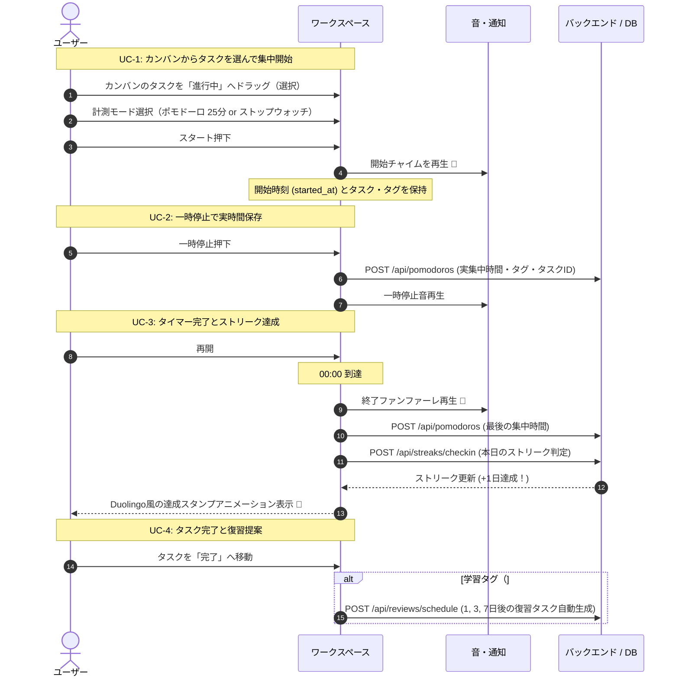
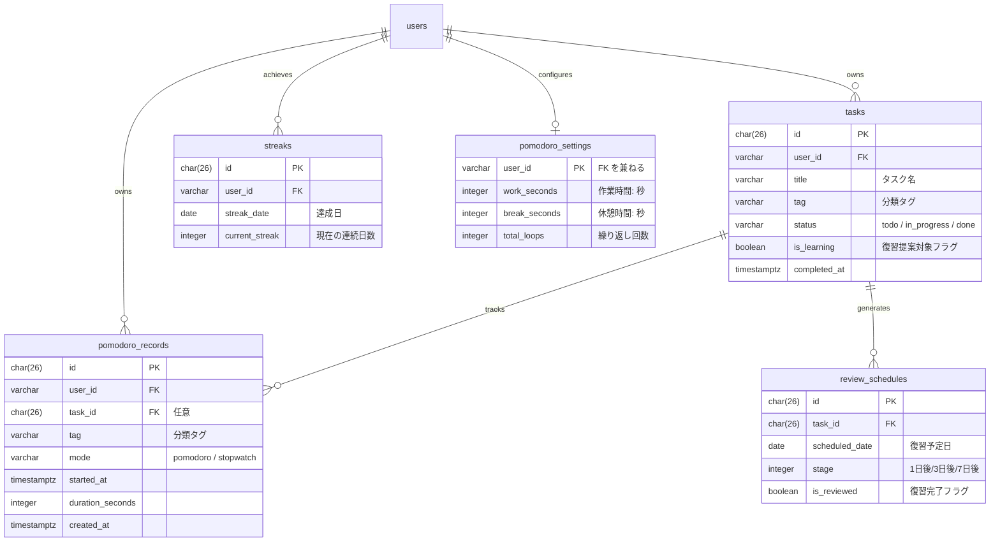

# プロダクト要求仕様書（PBT Web）

PBT Web（Personal Behavior & Productivity Toolkit）は、**「人生の有限性の意識（寿命カウンター）」** を原動力に、**「カンバンによるタスク整理」** と **「可変タイマー／ストップウォッチ」** を用いて没頭空間を作り出し、**「Duolingo 風ストリーク」** や **「忘却曲線に基づく復習提案」** によって日々の継続と学習成長を後押しする総合パーソナル生産性プラットフォームである。

## 1. プロダクトビジョンと目的（Why & What）

### 解決する課題

1. **先延ばしと時間浪費**: 人生の時間（活動時間）が有限であることを忘れ、漫然と過ごしてしまう。
2. **作業前の迷い**: 「今何をすべきか」の整理ができておらず、作業の着手が遅れる。
3. **作業リズムの硬直化**: 従来の 25 分固定ポモドーロでは、作業の性質や当日の集中力に合わず挫折する。
4. **習慣化の挫折**: 三日坊主になりやすく、日々の頑張りが報われるフィードバック（ストリークやスタンプ）がない。
5. **学習内容の忘却**: 学んだ知識の復習タイミングが分からず、せっかく集中した内容が定着しない。

### コア価値

- **時間意識の覚醒**: 寿命カウンターと今日のリミット表示により、今この瞬間の集中を動機づける。
- **柔軟な没頭スタイル**: 15分/25分/50分などの可変カウントダウンと、上限なしのストップウォッチを自由に選べる。
- **完全な集中実績ログ**: 一時停止や中断も含め、実作業時間を 1 秒も無駄にせず記録する。
- **習慣と成長のループ**: 毎日のストリークスタンプと忘却曲線に基づく復習提案で、継続と定着を自動化する。

## 2. コア機能モジュール（7つの柱）

| モジュール         | 機能名                   | 概要と提供価値                                                                      |
| :----------------- | :----------------------- | :---------------------------------------------------------------------------------- |
| **① 計測エンジン** | **可変ポモドーロ**       | 15分/25分/50分/自由入力で時間枠を設定できるカウントダウン。                         |
|                    | **ストップウォッチ**     | 上限を決めずに作業を始め、実時間を記録するカウントアップ。                          |
|                    | **音と通知**             | 開始の合図チャイム、終了のアラーム音、ブラウザ Web 通知。                           |
| **② タスク管理**   | **カンバンボード**       | 「未着手（To Do）」「進行中（In Progress）」「完了（Done）」の 3 列管理。           |
| **③ 習慣・継続**   | **ストリーク・スタンプ** | Duolingo 風に連続達成日数を記録し、ログイン・達成時にスタンプを表示。               |
| **④ 時間意識**     | **寿命カウンター**       | 人生の残り活動時間や今日の活動リミットを可視化し、集中を促す。                      |
| **⑤ 学習支援**     | **復習日の自動提案**     | エビングハウスの忘却曲線に基づき、完了タスクの復習日（1, 3, 7, 30日後）を自動起案。 |
| **⑥ 集中ログ**     | **セグメント記録**       | 一時停止・リセット・完了のすべてで実集中時間をタグ・タスク付きで永続化。            |
| **⑦ 統計・分析**   | **生産性ダッシュボード** | タグ別作業時間比率（円グラフ）、日次集中持続時間、時間帯別の波を可視化。            |

## 3. 画面レイアウト（カンバン × 計測ワークスペース）

```text
+---------------------------------------------------------------------------------+
|  ⏳ 人生残り活動時間: 約 420,500 時間  |  🔥 連続 12 日ストリーク！ (本日のスタンプ済)   |
+------------------------------------+--------------------------------------------+
|  📋 カンバンボード                   |  ⏱️ 計測ワークスペース                      |
|                                    |                                            |
|  [未着手]   [進行中]    [完了]      |  [ ポモドーロ (25m) ▼ ]  [ ストップウォッチ ] |
|  +------+  +------+    +------+    |                                            |
|  |TaskA |  |TaskB |    |TaskC |    |  対象タスク: 【TaskB: API設計】 #開発        |
|  |#開発 |  |#開発 |    |#読書 |    |                                            |
|  +------+  +------+    +------+    |                   24:18                    |
|             (選択中)                |                                            |
|                                    |        [ 一時停止 🔔 ]  [ リセット ]        |
|  📅 復習リマインド (今日: 2件)       |                                            |
|  ・英単語 Chapter 3 (7日目復習)     |  今日の実績: 2時間15分 (4セッション)        |
+------------------------------------+--------------------------------------------+
```

## 4. 主要ユースケース（User Scenarios）



## 5. コア業務ルール（Core Rules）

### 計測と保存ルール

1. **計測モード**:
   - カウントダウン（ポモドーロ）: 指定時間（デフォルト25分、15分/50分等への変更可）から 0 まで減算。
   - カウントアップ（ストップウォッチ）: 0 から上限なしで加算。
2. **保存トリガー**:
   - 一時停止、タイマー満了、リセット（10秒以上の実作業時間がある場合）のすべてで自動保存。
3. **音と通知**:
   - 開始時: 爽やかな短いチャイム。
   - 終了時: 達成感のあるアラーム音 + ブラウザデスクトップ通知。

### ストリーク（習慣化）ルール

1. **達成条件**: 1 日の中で **合計 25 分以上**（または 1 ポモドーロ以上）の集中セッションを記録した時点で、その日のストリークが成立。
2. **スタンプ演出**: 条件達成時、または達成後の初回ログイン時に「今日のスタンプ」が押されるアニメーションを表示。
3. **途切れ防止（フリーズ機能）**: 週に 1 日だけ休息日（ストリーク維持）を許容する救済ルール（将来構想）。

### 復習日提案ルール（エビングハウスの忘却曲線）

1. **対象タスク**: 学習系タグ（例: `#勉強`, `#読書`, `#英語` 等）を持つ完了タスク。
2. **リマインドスケジュール**:
   - 1 回目復習: 完了の **翌日（+1日）**
   - 2 回目復習: 完了の **3日後（+3日）**
   - 3 回目復習: 完了の **7日後（+7日）**
   - 4 回目復習: 完了の **30日後（+30日）**
3. **提案の挙動**: カンバンボードの「復習リマインド」枠に自動で復習タスクカードがレコメンドされる。

### 寿命・活動時間カウンタールール

1. **設定**: ユーザーの生年月日（または目標年齢、例: 80歳）および 1 日の目標活動時間（例: 8時間）を設定。
2. **表示**: 「人生で活動できる残りの推定時間」および「今日残された活動時間」を秒単位で静かにカウントダウン表示し、時間の有限性をリマインドする。

## 6. データモデル設計（全体像）



## 7. 段階的ロードマップ（3 つのフェーズ）

- **フェーズ 1 (現在・コア計測 & フィードバック)**:
  - タイマーの一時停止・リセット・完了の実時間セグメント保存
  - 作業時間の可変設定（15分/25分/50分/自由入力）
  - ストップウォッチモード（カウントアップ）の実装
  - 開始・終了の音とお知らせ（Web Audio API / Notification API）
  - タグ付き保存（`tag VARCHAR(50)`）
- **フェーズ 2 (カンバン & 習慣化)**:
  - カンバンボード（未着手 / 進行中 / 完了）の実装
  - タスク選択と計測の連動
  - Duolingo 風ストリーク機能（連続達成日数カウント & スタンプ演出）
  - タグ別・タスク別の作業時間グラフ
- **フェーズ 3 (自己管理 & 学習支援の極致)**:
  - 人生の有限性を意識させる寿命カウンター / 今日の活動リミット
  - 忘却曲線に基づく復習日の自動提案・通知
  - ストリークのフリーズ（救済）機能

## 決定理由（Rationale）

- **カンバンとストップウォッチを追加した理由**:
  「25分枠の固定タイマー」だけでは、長時間のコーディングや執筆、読書といった多様な活動に対応しきれず、タスクの進捗状況も視覚化できないため。
- **ストリークと寿命カウンターを同居させる理由**:
  「寿命カウンター（時間の有限性という健全な危機感）」で着手を促し、「ストリークスタンプ（達成の快感）」で毎日の継続を強化するという、心理学的に最も強力な動機づけループを作るため。
- **忘却曲線を取り入れた理由**:
  単なる作業トラッカーにとどまらず、「勉強や読書の学習定着」まで支援することで、ユーザーの長期的な自己投資のパートナーとなるため。

## See also

- [ポモドーロ機能 実装仕様・データフロー](/frontend/features/pomodoro.md)
- [pomodoro_records テーブル定義](/database/pomodoro-records.md)
- [Package by Feature 設計指針](/knowledge/package-by-feature.md)
- [文書の構成ガイドライン](/guides/document-structure.md)
