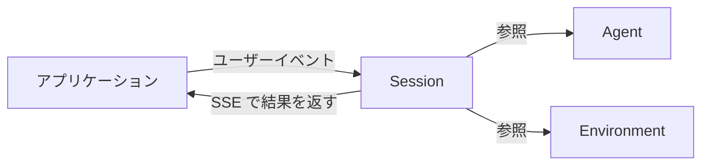

# Claude Managed Agents の概要

Claude Managed Agents は、Claude を自律型エージェントとして動かすためのハーネスとインフラを Anthropic が提供するサービス（ベータ版）。
独自のエージェントループやツール実行基盤を作らずに、ファイル読み取り・コマンド実行・ウェブ閲覧・コード実行ができるマネージド環境を使える。

## Messages API との違い

|            | Messages API                               | Claude Managed Agents                                                    |
| ---------- | ------------------------------------------ | ------------------------------------------------------------------------ |
| 概要       | モデルへの直接的なプロンプトアクセス       | マネージドインフラ上で動く、事前構築済みで設定可能なエージェントハーネス |
| 最適な用途 | カスタムエージェントループときめ細かな制御 | 長時間実行タスクと非同期作業                                             |

- prompt caching やコンパクションなどの最適化がハーネスに組み込まれている。
- Claude Platform on AWS でも利用できるが、機能やセッションの動作に一部違いがある。

## コアコンセプト

| 概念        | 説明                                                                                                             |
| ----------- | ---------------------------------------------------------------------------------------------------------------- |
| Agent       | モデル、システムプロンプト、ツール、MCP サーバー、スキル                                                         |
| Environment | セッションの実行場所。Anthropic 管理のクラウドサンドボックス、または自社インフラ上のセルフホスト型サンドボックス |
| Session     | 環境内で実行中のエージェントインスタンス。タスクを実行し出力を生成する                                           |
| Events      | アプリとエージェント間でやり取りするメッセージ（ユーザーターン、ツール結果、ステータス更新）                     |

## 仕組み

1. エージェントを作成する: モデル、システムプロンプト、ツール、MCP サーバー、スキルを定義する。作成後はセッションをまたいで ID で参照できる。
1. 環境を作成する: 実行場所（クラウドサンドボックス or セルフホスト型サンドボックス）を設定する。
1. セッションを開始する: エージェントと環境の設定を参照して起動する。
1. イベントを送信してレスポンスをストリーミングする: ユーザーメッセージをイベントとして送ると、Claude が自律的にツールを実行し、SSE（server-sent events）で結果を返す。イベント履歴はサーバー側に永続化され、全体を取得できる。
1. 誘導または中断する: 実行中のエージェントに追加のユーザーイベントを送って誘導するか、中断して方向を変える。

## 使用すべき場面

| 要件               | 内容                                                                                                                         |
| ------------------ | ---------------------------------------------------------------------------------------------------------------------------- |
| 長時間実行         | 複数のツール呼び出しを伴い、数分〜数時間かかるタスク                                                                         |
| クラウドインフラ   | パッケージ事前インストール済み・ネットワークアクセスありの安全なサンドボックス                                               |
| セルフホスト型実行 | コンプライアンスやデータレジデンシーのため、自社インフラ上で動かす                                                           |
| 最小限のインフラ   | 独自のエージェントループ・サンドボックス・ツール実行レイヤーが不要                                                           |
| ステートフル       | ファイルシステムと会話履歴が複数のインタラクションにわたって永続化される                                                     |
| スケジュール実行   | [スケジュールされたデプロイメント](https://platform.claude.com/docs/ja/managed-agents/scheduled-deployments)による cron 実行 |

## サポートされているツール

| ツール               | できること                                                            |
| -------------------- | --------------------------------------------------------------------- |
| Bash                 | サンドボックス内でシェルコマンドを実行                                |
| ファイル操作         | ファイルの読み取り・書き込み・編集・glob・grep                        |
| ウェブ検索とフェッチ | ウェブ検索と URL からの取得。ドメインの許可／ブロックリストで制限可能 |
| MCP サーバー         | 外部のツールプロバイダーに接続                                        |

完全なリストは[ツール](https://platform.claude.com/docs/ja/managed-agents/tools)を参照。

## ベータアクセスとデータ保持

- すべてのエンドポイントに `managed-agents-2026-04-01` ベータヘッダーが必要（SDK は自動で付与）。
- 開始に必要なもの:
  1. [Claude API キー](https://platform.claude.com/settings/keys)
  1. すべてのリクエストに `managed-agents-2026-04-01` ヘッダー
  1. Managed Agents へのアクセス（全 API アカウントでデフォルト有効）
- [MCP トンネル](https://platform.claude.com/docs/ja/agents-and-tools/mcp-tunnels/overview)と[ドリーミング](/references/claude/docs/managed-agents-dreams.md)はリサーチプレビューで、[アクセス申請](https://claude.com/form/claude-managed-agents)が必要。
- データ保持: セッションは会話履歴・サンドボックスの状態・出力をサーバー側に保存するため、現在ゼロデータ保持（ZDR）および HIPAA BAA の対象外。セッションやアップロードしたファイルは API でいつでも削除できる。

## See also

- [ドリーミング](/references/claude/docs/managed-agents-dreams.md)
- [Claude Managed Agents の概要（公式）](https://platform.claude.com/docs/ja/managed-agents/overview)
- [クイックスタート](https://platform.claude.com/docs/ja/managed-agents/quickstart)
- [リファレンス（レート制限・ブランディングガイドライン）](https://platform.claude.com/docs/ja/managed-agents/reference)
- [API とデータ保持](https://platform.claude.com/docs/ja/manage-claude/api-and-data-retention#feature-eligibility)
