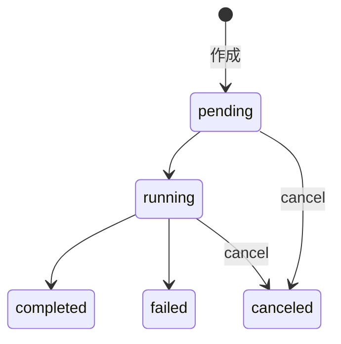

# Claude Managed Agents のドリーム（Dreams）

ドリームは、過去のセッションを Claude に振り返らせてエージェントのメモリストアを整理する非同期ジョブ（リサーチプレビュー）。
重複の統合、古い・矛盾するエントリの更新、新たなインサイトの抽出を行い、入力とは別の新しいメモリストアを出力する。

- メモリストアは既定では使われない。Managed Agents の各セッションは白紙のコンテキストで始まり、メモリストアを作成してセッション作成時に `resources[]` でアタッチする必要がある（実行中のセッションには後から添付できない）。
- ドリームには `memory_store` の入力が必須。既存のストアがなければ空のストアを作成して渡す。

## 概要

- エージェントが作業中に書き込む[メモリストア](https://platform.claude.com/docs/ja/managed-agents/memory)はローカルかつ増分的なので、セッションを重ねると重複・矛盾・古いエントリが溜まる。
- ドリームは既存のメモリストアと過去のトランスクリプトを読み込み、再編成したストアを生成する。
- 入力ストアは決して変更されない。出力を確認し、気に入らなければ破棄できる。
- 利用には[アクセス申請](https://claude.com/form/claude-managed-agents)が必要。

### ベータヘッダー

| 呼び出し                                     | 必要なヘッダー                                                                 |
| -------------------------------------------- | ------------------------------------------------------------------------------ |
| ドリームのエンドポイント                     | `managed-agents-2026-04-01` と `dreaming-2026-04-21` の両方                    |
| セッション（作成時のメモリストア添付を含む） | `managed-agents-2026-04-01` のみ                                               |
| メモリストア API（`/v1/memory_stores...`）   | `agent-memory-2026-07-22` のみ（`managed-agents-2026-04-01` と併用すると 400） |

- `managed-agents-2026-04-01` 単独ではドリームにアクセスできない。SDK はヘッダーを自動で設定する。
- ドリーム公式ページはメモリストア呼び出しも `managed-agents-2026-04-01` のみとするが、より新しいヘッダーを示すメモリ公式ページに従う。

## 仕組み

| 入出力 | 内容                                                                      |
| ------ | ------------------------------------------------------------------------- |
| 入力   | 既存のメモリストア（検証・重複排除・再編成の対象）                        |
| 入力   | 1〜100 件のセッション（パターンやインサイトを掘り起こすトランスクリプト） |
| 出力   | 入力とは別の出力メモリストア                                              |

- 出力ストアの ID は、ドリームが `running` になり入力ストアのクローンが終わった時点で `outputs[]` に表示される（`running` 直後は一時的に空のことがある）。
- 既存ストアがなくトランスクリプトだけある場合は、先に[空のメモリストアを作成](https://platform.claude.com/docs/ja/managed-agents/memory#create-a-memory-store)して入力に渡す。

## ドリームを作成する

```bash
curl -s https://api.anthropic.com/v1/dreams \
  -H "x-api-key: $ANTHROPIC_API_KEY" \
  -H "anthropic-version: 2023-06-01" \
  -H "anthropic-beta: managed-agents-2026-04-01,dreaming-2026-04-21" \
  -H "content-type: application/json" \
  --data @- <<EOF
{
  "inputs": [
    { "type": "memory_store", "memory_store_id": "$store_id" },
    { "type": "sessions", "session_ids": ["$session_a", "$session_b"] }
  ],
  "model": "claude-opus-4-8",
  "instructions": "Focus on coding-style preferences; ignore one-off debugging notes."
}
EOF
```

TypeScript SDK の場合:

```typescript
let dream = await client.beta.dreams.create({
  inputs: [
    { type: 'memory_store', memory_store_id: storeId },
    { type: 'sessions', session_ids: [sessionA, sessionB] },
  ],
  model: 'claude-opus-4-8',
  instructions: 'Focus on coding-style preferences; ignore one-off debugging notes.',
});
console.log(dream.id); // drm_01...
```

- `model` はドリーミングパイプラインを実行するモデル（対応モデルは「制限」を参照）。
- レスポンスは `status: "pending"`、`outputs: []` の `dream` リソース。

### instructions で誘導する

`instructions`（任意）はパイプライン全体に適用される高レベルの統合ガイダンス。

- 向いている: 重点領域（「コーディングスタイルの好みに焦点を当てる」）、変更せず保持すべき内容、出力ストア全体の規約。
- 向いていない: 特定の行を狙う命令（「文 X を Y に変更する」）。パイプラインはエディタではなく統合パスなので、通常は何も変わらない。
- 個々のメモリを直接直したい場合は、出力ストアに対して [Memory Stores API](https://platform.claude.com/docs/ja/managed-agents/memory#view-and-edit-memories) を使う。

## 進捗を追跡する

ドリームは非同期で、入力トランスクリプト数に応じて数分〜数時間かかる。ID でポーリングする。

```bash
while true; do
  dream=$(curl -s "https://api.anthropic.com/v1/dreams/$dream_id" \
    -H "x-api-key: $ANTHROPIC_API_KEY" \
    -H "anthropic-version: 2023-06-01" \
    -H "anthropic-beta: managed-agents-2026-04-01,dreaming-2026-04-21")
  status=$(jq -r '.status' <<< "$dream")
  echo "status=$status input_tokens=$(jq -r '.usage.input_tokens' <<< "$dream")"
  [[ "$status" == "pending" || "$status" == "running" ]] || break
  sleep 10
done
```

### ライフサイクル



| `status`    | 意味                                                         |
| ----------- | ------------------------------------------------------------ |
| `pending`   | 作成されキューに入った                                       |
| `running`   | パイプライン処理中。進行に応じて `usage` が更新される        |
| `completed` | 正常完了。`outputs[]` の値が新しいメモリストア               |
| `failed`    | エラーで終了。出力ストアは失敗前に書き込まれた内容のまま残る |
| `canceled`  | キャンセルされた。出力ストアはそのまま残る                   |

### パイプラインの実行を監視する

`running` 中は `session_id` がパイプラインを実行している[セッション](https://platform.claude.com/docs/ja/managed-agents/sessions)を指す。その[イベント](https://platform.claude.com/docs/ja/managed-agents/events-and-streaming)をストリーミングすれば、何を読み書きしているかをリアルタイムで観察できる。終了後、そのセッションは削除ではなくアーカイブされるので、トランスクリプトは引き続き参照できる。

## 出力を使用する

`completed` になると、`outputs[]` の `memory_store` エントリは通常のメモリストアとして使える。Memory Stores API か Console で中身を確認してから、次のどちらかを行う。

- 活用する: 入力ストアの代わりに（または併用して）、今後のセッションに `memory_store` リソースとしてアタッチする。
- 破棄する: [削除](https://platform.claude.com/docs/ja/api/beta/memory_stores/delete)または[アーカイブ](https://platform.claude.com/docs/ja/api/beta/memory_stores/archive)する。

```bash
output_store_id=$(jq -r 'first(.outputs[] | select(.type == "memory_store")).memory_store_id' <<< "$dream")

curl -s https://api.anthropic.com/v1/sessions \
  -H "x-api-key: $ANTHROPIC_API_KEY" \
  -H "anthropic-version: 2023-06-01" \
  -H "anthropic-beta: managed-agents-2026-04-01" \
  -H "content-type: application/json" \
  --data @- <<EOF
{
  "agent": "$agent_id",
  "environment_id": "$environment_id",
  "resources": [
    { "type": "memory_store", "memory_store_id": "$output_store_id" }
  ]
}
EOF
```

- `failed` / `canceled` でも出力ストアは部分的な内容のまま残る。不要なら Memory Stores API で片付ける。
- 注意: 実行中に入力メモリストアをアーカイブ・削除したり、入力セッションを削除したりすると、ドリームは `input_memory_store_unavailable` / `input_session_unavailable` で失敗する（実行中の 400 ガードはドリーム自体のアーカイブにしか効かない）。

## キャンセル・アーカイブ・一覧

| 操作       | エンドポイント                 | 挙動                                                                                                                                                 |
| ---------- | ------------------------------ | ---------------------------------------------------------------------------------------------------------------------------------------------------- |
| キャンセル | `POST /v1/dreams/{id}/cancel`  | `pending` / `running` を即 `canceled` に。`canceled` への再実行は no-op。`completed` / `failed` は 400                                               |
| アーカイブ | `POST /v1/dreams/{id}/archive` | 終了状態のドリームに `archived_at` を設定（`status` は不変）。再実行は no-op。`pending` / `running` は 400（先にキャンセル）。アーカイブ解除はない   |
| 一覧       | `GET /v1/dreams?limit=20`      | アーカイブされていないドリームを新しい順に返す。`limit`（デフォルト 20、最大 100）と `page` カーソル。`include_archived=true` でアーカイブ済みも含む |

- キャンセル後も数秒間 `usage` が更新されることがある。最終値が必要なら安定するまでポーリングする。
- ドリームをアーカイブしても出力メモリストアには影響しない。出力ストアは Memory Stores API で別途管理する。

## エラー

| `error.type`                      | 発生条件                                                     |
| --------------------------------- | ------------------------------------------------------------ |
| `timeout`                         | パイプラインが実行時間の上限を超えた                         |
| `internal_error`                  | 分類されていないパイプラインの失敗                           |
| `memory_store_org_limit_exceeded` | 作業用ストレージの用意中に、組織がメモリストアの上限に達した |
| `input_memory_store_too_large`    | 入力メモリストアがパイプラインのサイズ制限を超えている       |
| `input_memory_store_unavailable`  | 作成後に入力メモリストアがアーカイブまたは削除された         |
| `input_session_unavailable`       | 作成後に入力セッションが削除された                           |

この一覧は網羅的ではない。

## 課金と制限

選択したモデルの標準 API トークン料金で課金され、正確な合計は `usage` に出る。コストは入力セッションの数と長さにほぼ比例するので、少数のセッションで試し、整理の品質に満足してからスケールアップする。

| 制限                         | 値                                                                                                              |
| ---------------------------- | --------------------------------------------------------------------------------------------------------------- |
| ドリームあたりのセッション数 | 100                                                                                                             |
| `instructions` の長さ        | 4,096 文字                                                                                                      |
| サポートされるモデル         | `claude-opus-5`、`claude-fable-5`、`claude-opus-4-8`、`claude-opus-4-7`、`claude-sonnet-5`、`claude-sonnet-4-6` |

リサーチプレビュー中はデフォルトのレート制限が適用される。引き上げは[サポート](https://support.claude.com)に問い合わせる。

## See also

- [Claude Managed Agents の概要](/references/claude/managed-agents-overview.md)
- [ドリーム（公式）](https://platform.claude.com/docs/ja/managed-agents/dreams)
- [メモリ（公式）](https://platform.claude.com/docs/ja/managed-agents/memory)
