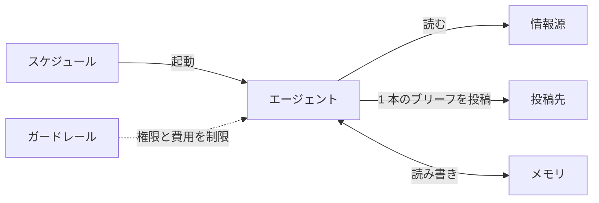

# 効果的なエージェント自動化の作り方

Claude ブログの記事 [Building effective agent automations][article]（Lance Martin、CJ Avilla、2026-10-08 公開）の要約。Slack や GitHub などの情報源を定期的に読み、前回の実行から変わったことを 1 本の要約（ブリーフ）として投稿するエージェントの参照実装を、[Claude Managed Agents](/references/claude/docs/managed-agents-overview.md)（ベータ版）の上で組み立てて解説している。よくある失敗パターンと、それを防ぐルールが記事の中心である。

[article]: https://claude.dev/blog/building-effective-agent-automations/

## 記事の参照実装（Get the code）

著者らは、独自の情報源を定期的に読み、前回からの変化を追跡し、読み手が知るべきことを投稿する参照実装を用意している。

- 構成は設定ファイルの集まりである: `agent.md`、`deployment.md`、`environment.yaml`、メモリストアのファイル、`vault.yaml`。
- `ant apply` コマンドが、これらの設定ファイルを Claude API のリソースに変換する。
- 動かすには Slack アプリと GitHub トークンが必要である。
- 一度設定すれば Anthropic のインフラ上でスケジュール実行されるので、手元のマシンで何かを動かし続ける必要はない。

## 全体の構成（Overview）

エージェントは 6 つの部品からなる。

| 部品                       | 役割                                       |
| -------------------------- | ------------------------------------------ |
| 情報源（sources）          | エージェントが読む先（Slack、GitHub など） |
| 投稿先（destination）      | ブリーフを投稿する先                       |
| エージェント（agent）      | モデル、システムプロンプト、ツールの設定   |
| スケジュール（schedule）   | エージェントを起動するタイミング           |
| メモリ（memory）           | 実行をまたいで残す設定と状態               |
| ガードレール（guardrails） | できることと使える費用の制限               |

記事の構成図では、スケジュールがエージェントを起こし、エージェントが情報源を読んで 1 本のブリーフを投稿し、その周りをメモリとガードレールが囲んでいる。

## 情報源（Sources）

既定の情報源は Slack のチャンネルと GitHub のプルリクエストで、設定ファイル（preferences）に列挙する。

### エージェント専用の、範囲を絞った認証情報を渡す

- 認証情報は vault（秘密情報の保管庫）に置く。本物の値は vault に残り、Claude のコードが動くサンドボックスの中には入らない。
- GitHub への呼び出しは、サンドボックスの外にある MCP プロキシを経由する。
- Slack への呼び出しはプレースホルダーのトークン（`$SLACK_BOT_TOKEN`）を使い、許可されたホストへの通信のときだけ、プラットフォームが本物のトークンに差し替える。

### 前回読んだところから読む

固定の時間幅（「過去 24 時間」など）ではなく、ブックマークから読む。固定の時間幅だと、実行が遅れたときに抜けが生じ、早まったときに重複が生じるためである。

- 情報源ごとに、最後に読んだ最新のタイムスタンプを `state` メモリストアの `bookmarks.json` に保存する。

### 読み取りの失敗を「静かな日」と取り違えない

よくある落とし穴として、サーバーの停止やトークンの期限切れで読み取りに失敗すると、エージェントはその情報源から何も見えず「新しいことはない」と報告してしまう。

> 引用: "sees nothing from that source and reports 'nothing new.'"

対策は次のとおりである。

1. 失敗した情報源のブックマークは動かさない。
1. ほかの情報源の内容は通常どおり報告する。
1. 読めなかった情報源を名指しする 1 行をブリーフに加える。

## 投稿先（Destination）

エージェントは 1 回の実行につき、日付入りのブリーフを 1 本、1 つの Slack チャンネルに投稿する。投稿は `curl` で `chat.postMessage` を呼ぶ。bash は既定で承認なしに動くので、投稿を承認する仕組みはない。

### 投稿が届いたことを確かめてから記録する

投稿の消失と重複の両方を防ぐため、次の手順を踏む。

1. 投稿前に、今日の号がすでにチャンネルにあるかを確かめる。
1. Slack の応答に `"ok": true` とメッセージの `ts` があるときだけ、投稿済みとみなす。
1. その確認が取れてから、台帳（ledger）とブックマークを更新する。
1. 結果がはっきりしないときは、その実行を「投稿したかもしれない（maybe posted）」と記録し、ほかには何も変えない。

## エージェント（Agent）

エージェントは、モデル、システムプロンプト、ツールをまとめたバージョン付きの設定である。この実装では `agent.md` の Frontmatter に名前、モデル、MCP サーバー、ツールを書き、本文に実行の 8 つの手順を書く。

- GitHub のツールは `always_allow` にする。無人で動くので、呼び出しを承認する人がいないためである。その代わり GitHub トークンは読み取り専用にする。
- 記事中のリンクは、手で組み立てず、情報源が返すリンクのフィールドからそのまま写す。

### ブリーフを短く保つ

簡潔さのルールは「迷ったら載せない」である。

> 引用: "When unsure, leave it out."

### 未解決の項目は投稿の直前に確かめ直す

投稿する前に、すべての項目の最新の状態を確かめ直す。古い「まだあなたの対応待ち」が 1 つあるだけで、項目が 10 個抜けているより信頼を損なう、というのが著者らの主張である。そのため項目の状態をぼかして書かず、言い切るか、載せないかのどちらかにする。

> 引用: "One stale 'still waiting on you' costs more trust than ten missing items, so never hedge an item's status: assert it or drop it."

## スケジュール（Schedule）

エージェントを動かすのは `deployment.md` に書くデプロイメントである。

- cron 式（例: `32 7 * * 1-5`）、タイムゾーン（例: `America/New_York`）、vault の ID、マウントするメモリストア、最初のメッセージを設定する。
- 起動のたびに新しいセッションが始まる。
- 動作確認には `ant beta:deployments run` で手動実行するとよい。

### 日付は自分のタイムゾーンで計算する

よくあるバグは、サーバーのタイムゾーンで日付を計算してしまうことである。そのためデプロイメントの本文で、すべての日付を設定したタイムゾーンで求めるよう指示する。

## メモリ（Memory）

各実行は、それまでの実行の記憶を持たずに始まる。そこでメモリストアを 2 つに分ける。

| ストア        | エージェントの権限 | 中身                                                           |
| ------------- | ------------------ | -------------------------------------------------------------- |
| `preferences` | 読み取り専用       | 読み手が書く設定（情報源の一覧など）                           |
| `state`       | 読み書き           | ブックマーク、台帳、実行記録、設定変更の提案、情報源ごとのメモ |

### 毎回の実行の最初に設定を読み直す

エージェントは実行のたびに `preferences` を読み直す。ファイルを読めなかったときは、既定値で走り続けずに止まり、読めなかったと伝える。

> 引用: "If it can't read the file, it should stop and say so instead of running on defaults."

### 報告済みの項目を台帳に残し、変化を報告する

報告した項目は、安定した ID とともに台帳に記録する（例: `2026-09-11 github 481 review blocked, day 2 (still waiting)`）。こうすることで、同じ項目を繰り返したり、まだ続いている項目を誤って落としたりせず、前回からの変化だけを報告できる。

## ガードレール（Guardrails）

ガードレールは、エージェントにできることと、使える費用の 2 つを制限する。

### できることの制限

- GitHub トークンと `preferences` は読み取り専用にする。
- サンドボックスからは、許可リストに載ったホストにしか接続できない。
- 情報源に仕込まれた指示（プロンプトインジェクション）があっても、ブリーフの中身は変えられうるが、GitHub に書き込んだりルールを書き換えたりはできない。
- Slack は例外で、同じトークンで読みも投稿もする。そのため bot は必要なチャンネルにだけ招待する。

### 費用の上限は実際の実行から決める

- 費用の上限は `deployment.md` の `budget` で設定する。例えば `amount: "500"` はセント単位なので 5.00 ドルである。
- 最初は、通常の 1 回の実行にかかる費用の 3〜5 倍に設定することを勧めている。
- 上限に達した実行は失敗ではなく一時停止になる。そのため上限が低すぎると、ブリーフが単に静かになったように見えてしまう。

## 始め方（Getting started）

記事は、ここまでの内容を 6 つのルールにまとめている。

1. 各情報源は、固定の時間幅ではなくブックマークから読む。
1. 読み取りの失敗は「読めなかった」と報告し、決して「静かな日」として扱わない。
1. 投稿の直前に、すべての項目を確かめ直す。
1. Slack が確認を返したときだけ投稿済みとみなし、それからブックマークと台帳を更新する。
1. 設定は毎回の実行で、エージェントが編集できないストアから読み直す。
1. 読むだけの場所には読み取り専用の権限を与え、1 回の実行で使える費用に上限を設ける。

セットアップは、`claude update` のあと `/claude-api managed-agents-onboard <記事の URL>` を実行する。このコマンドが設定案を提示し、`ant apply` でリソースを作成する。

## See also

- [Claude Managed Agents の概要](/references/claude/docs/managed-agents-overview.md)
- [Claude Managed Agents のドリーム（Dreams）](/references/claude/docs/managed-agents-dreams.md)
- [Building effective agent automations（原文）][article]
- [スケジュールされたデプロイメント（公式）][scheduled-deployments]

[scheduled-deployments]: https://platform.claude.com/docs/ja/managed-agents/scheduled-deployments
